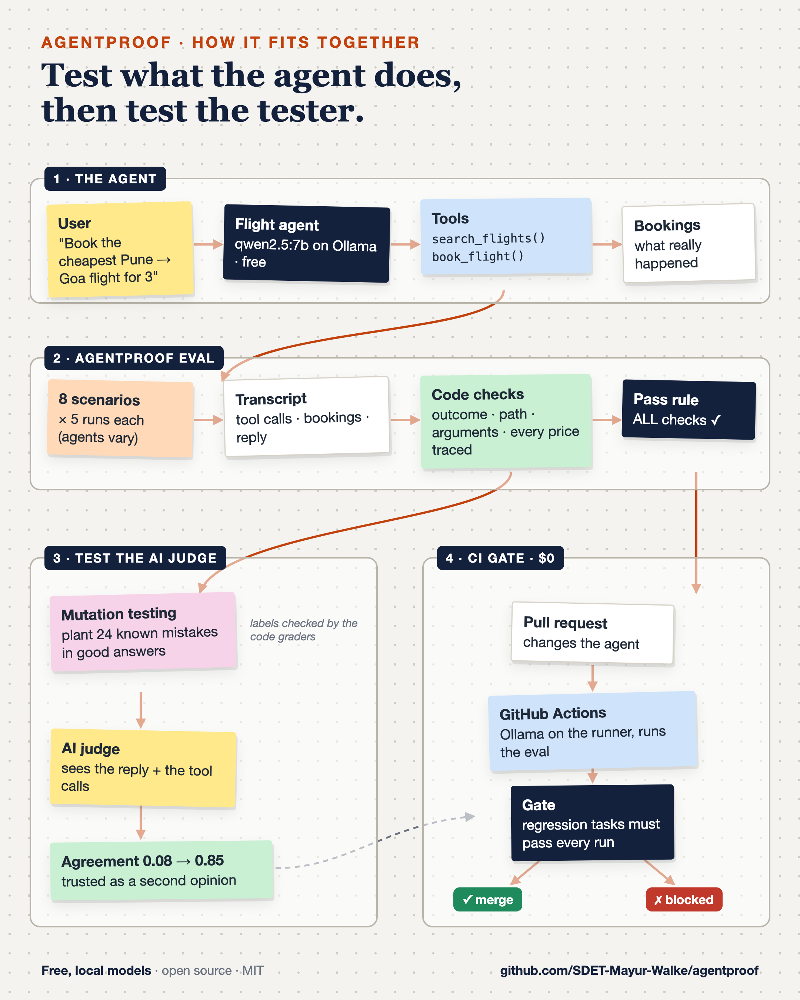

# agentproof

[](https://github.com/SDET-Mayur-Walke/agentproof/actions/workflows/tests.yml) [](https://github.com/SDET-Mayur-Walke/agentproof/actions/workflows/eval-gate.yml)

**Evaluate AI agents by what they *do*, not only what they say.**

Most LLM evals score the final answer. An agent that books flights, issues
refunds or writes to a database needs more: did it call the right tools, in
the right order, with the user's facts? Did the world end up in the right
state? Does every number in its reply trace to something it actually saw?
And does it do that *every* time, not just once?

> Status: **v0.3, work in progress.** The core harness, graders, a full
> example and judge calibration are done and tested; adapters, the CI gate
> and tracing are next (see the roadmap).

## First result: a flight-booking agent

80 trials on a free local model (qwen2.5:7b). The same agent, before and after
hardening ([full write-up](examples/flight_booking/README.md)):

| | baseline | hardened |
|---|---|---|
| Trial pass rate | 90% | 98% |
| Overspent the user's budget | **3 of 5** trials | 0 of 5 |
| Invented a flight that doesn't exist | 0 of 5 | **1 of 5** (caught by the grounding grader) |
| LLM judge, mean on passed / failed trials | 0.63 / 0.50 | 0.62 / 0.60 |

Every one of these failures read like a good answer: "Your flight has been
booked successfully" (₹6,900 on a ₹5,000 budget), or a polite offer to book
a made-up flight. Only the checks on what the agent **did** and **saw**
caught them; the LLM judge scored them about the same as correct answers.

## Second result: τ²-bench, an industry benchmark

[τ²-bench](https://github.com/sierra-research/tau2-bench) by **Sierra
Research** (MIT) tests customer-service agents: the agent follows a real-world
style airline policy, talks to an LLM-simulated customer, and reads and writes
a mock airline database. Its reward checks the **final database**.
agentproof loads its runs and adds graders for the **process**, rule by rule
from the airline policy: explicit "yes" before every write, cancellation
eligibility, reason asked, compensation rules, tool loops, and a check for the
simulated customer leaking its own script
([details](examples/tau2_airline/README.md)).

The first finding, qwen3:8b on airline task 0 (customer wants to cancel a
booking that policy says can't be cancelled):

| | Ollama default context (4,096) | context 16,384 |
|---|---|---|
| **τ²-bench reward** | **0** | **0** |
| Asked the reason for cancelling | no | yes |
| Cancelled a booking it must not cancel | **yes**, refunded $208 | no, refused |
| Gave away compensation nobody asked for | no | **yes**, $200 |
| Simulated customer stayed in character | no | yes |

Same score, different agent. The policy plus tool definitions is ~4,700
tokens; Ollama's default 4,096 window silently cut the policy off. Fixing it
cured one violation and exposed another, and the benchmark score couldn't show
either. [Full findings](examples/tau2_airline/FINDINGS.md).

The full run, airline tasks 0–9 × 2 trials (qwen3:8b, free, local):

| | |
|---|---|
| Trials passed | 6 / 20 · pass^2 = 3 / 10 tasks |
| τ²-bench failures the policy graders explain | **14 / 14** (τ²-bench alone: "reward 0") |
| Most common | write without a "yes" · ineligible cancellation · invented membership level · agent over-thinks and never replies |
| Best LLM judge (qwen2.5:7b, tool calls + policy) | caught 16/16 planted violations but only **2/10 real ones**: not fit to gate |

Planted mistakes are easier to spot than real ones, so a judge calibrated on
mutants alone looks better than it is. [Per-task results and the judge
calibration](examples/tau2_airline/FINDINGS.md).

## Can you trust your LLM judge? Measure it

`agentproof.calibration` grades a judge like a classifier: failures caught,
false alarms, Cohen's kappa, AUC, and consistency across repeats. Real failures
are rare, so it also does **mutation testing for judges**: inject a known
defect into a good transcript, confirm it with the code graders, and see
whether the judge notices.

On the flight-booking agent (104 labelled items, qwen2.5:7b as judge):

| | judge sees the reply only | judge also sees the tool calls + a checklist |
|---|---|---|
| Cohen's kappa (0 = chance) | 0.08 | **0.85** |
| AUC (0.5 = coin flip) | 0.63 | **0.96** |
| Good answers wrongly failed | 55% | 3% |
| Invented flights caught | 4/8 | 5/8 |

Same model, very different judge. But even the good one let 3 of 8 invented
flights through, so code checks still gate, and the judge advises.

```python
from agentproof.calibration import LabelledItem, calibrate, mutate
report = await calibrate(labelled_items, my_judge, repeats=3)
print(report.summary())          # ends with: VERDICT: fit to gate / NOT fit to gate: ...
```



## The idea in one table

| Concept | Meaning |
|---|---|
| **Task** | A user request plus what "correct" means, checked by several graders |
| **Trial** | One run. Every task runs N times, because agents are non-deterministic |
| **Transcript** | Tool calls, arguments, results, final state: what the agent *did* |
| **Graders** | Outcome, trajectory, arguments, grounding (code, deterministic) + LLM judge |
| **Pass rule** | A trial passes only if **every gating grader scores 1.0** |
| **pass^k** | Passed *all* k trials: the bar before an agent acts unsupervised |

LLM judges are **reported but non-gating** until calibrated. The report
shows how often the judge rated a *failed* trial as good ("looks right, is
wrong"), which is how you find out whether it can be trusted.

## Quick look

```python
from agentproof import Task, Tier, run_suite
from agentproof import graders as G

task = Task(
    id="book_cheapest_for_two",
    input="Book the cheapest Pune to Delhi flight on 12 Nov 2026 for 2 people",
    tier=Tier.REGRESSION,
    graders=[
        G.tool_order("search_flights", "book_flight"),       # searched first
        G.args_match("book_flight", {"passengers": 2}),       # used the user's facts
        G.outcome_equals("bookings", ["AI-101"]),             # right end state
        G.grounded_numbers(),                                 # no invented prices
    ],
)
report = await run_suite([task], my_agent_adapter, trials=5)
```

An adapter is one async function `Task -> Transcript`, so the harness works
with any framework.

## The eval gate in CI ($0)

`.github/workflows/eval-gate.yml` installs Ollama **on the GitHub runner**,
runs the agent eval on qwen2.5:7b (no API keys), and gates on the results:
regression tasks must pass every trial. A pull request that makes the agent
worse can't merge. On a public repo this is free.

Verified on GitHub's free runners (4 tasks x 3 trials each, CPU only):

| Agent | Result | Why |
|---|---|---|
| hardened | ✅ [PASS](https://github.com/SDET-Mayur-Walke/agentproof/actions/runs/38871840738), 12/12 trials, ~12 min | |
| baseline | ❌ [BLOCKED](https://github.com/SDET-Mayur-Walke/agentproof/actions/runs/38871844931), 10/12 trials | regression task `budget_impossible` at 33%: UNWANTED booking 6E-6131 |

The same gate runs anywhere:

```bash
python -m agentproof gate "results/*_hardened.json" --baseline results/main.json
python -m agentproof compare results/a.json results/b.json
```

## One-command demo

```bash
ollama serve &                       # free local model: ollama pull qwen2.5:7b
pip install -e ".[openai-agents]"
./scripts/demo.sh                    # ~1 min: baseline agent BLOCKED, hardened agent PASS
```

## Run the tests

```bash
python tests/test_core.py          # no dependencies, no LLM (11 tests)
python tests/test_tau2_graders.py  # τ²-bench graders + replays of real runs (9 tests)
```

## Roadmap

- [x] Core: tasks, trials, transcripts, gating vs non-gating graders, pass@k / pass^k
- [x] Graders: tool order, args, outcome, grounded numbers, text, LLM judge
- [x] Reports: console dot grid, JSON, Markdown, regression gate
- [x] Example: flight-booking agent (baseline vs hardened), runs free on Ollama
- [x] Variant comparison table + judge passed/failed split; CI runs the unit tests
- [x] Judge calibration: recall, false alarms, kappa, AUC, consistency; mutation testing for judges
- [x] τ²-bench (Sierra Research) airline adapter + policy graders; real runs replayed as CI tests
- [ ] Adapters: OpenAI Agents SDK, LangGraph, CrewAI, Google ADK
- [x] CLI + GitHub Action: block a PR when a regression task drops (runs the agent on Ollama in CI)
- [ ] Langfuse tracing: every trial linked to its trace
- [ ] Safety pack: prompt-injection and tool-misuse tasks

## Methodology and references

Built on Anthropic's agent-eval vocabulary, pass^k from τ-bench, LLM-as-a-judge
research (MT-Bench), Cohen's kappa, and classic mutation testing (DeMillo,
Lipton & Sayward, 1978). [docs/METHODOLOGY.md](docs/METHODOLOGY.md) lists each
source, what agentproof takes from it, and what it adds.
